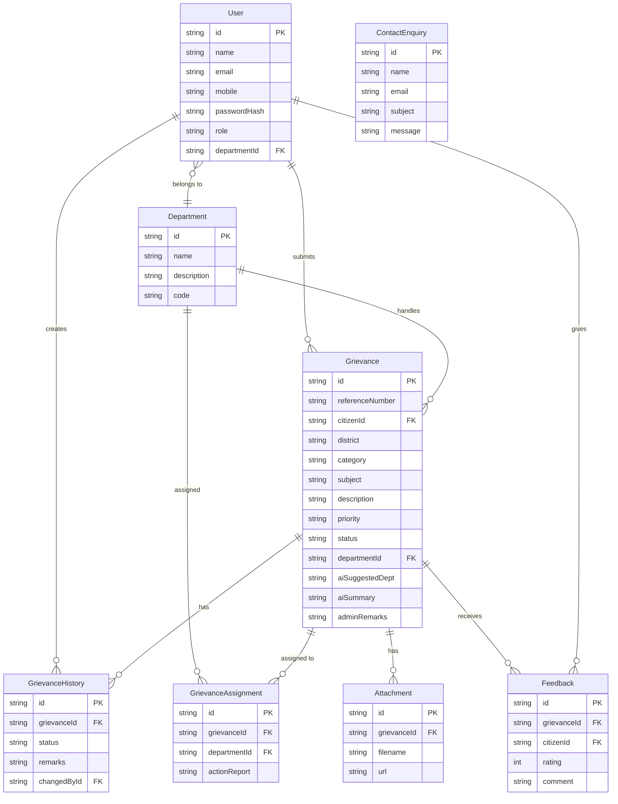

# Entity-Relationship Diagram
## CM Kerala – Chief Minister's Public Grievance Redressal Portal

---

## Relationship Descriptions

| Relationship | Cardinality | Description |
|-------------|-------------|-------------|
| User → Grievance | 1 : Many | A citizen can submit multiple grievances |
| User → GrievanceHistory | 1 : Many | A user (any role) can create many history entries |
| User → Department | Many : 1 | Many officers can belong to one department |
| Department → Grievance | 1 : Many | A department handles many assigned grievances |
| Department → GrievanceAssignment | 1 : Many | A department can have many assignment records |
| Grievance → GrievanceHistory | 1 : Many | A grievance has a full audit history |
| Grievance → GrievanceAssignment | 1 : Many | A grievance can be (re)assigned |
| Grievance → Attachment | 1 : Many | A grievance can have multiple file attachments |
| Grievance → Feedback | 1 : Many | (In practice 1:1 — one feedback per grievance) |
| User → Feedback | 1 : Many | A citizen can give feedback on each resolved grievance |

---

## Notes

- `ContactEnquiry` is a **standalone entity** — it has no foreign key relationships with any other table
- `GrievanceHistory` is **append-only** — records are never updated or deleted
- `User.departmentId` is only populated for `OFFICER` role users
- `Grievance.departmentId` is set by CMO admin when assigning the grievance
- All primary keys use **CUID** format (`@default(cuid())`)
